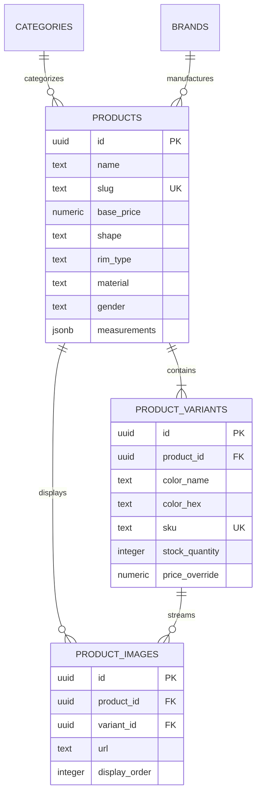
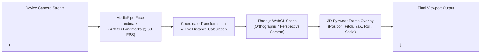

# Product Catalog, Multi-Color Variants & 3D Virtual Try-On

> **Eyewear SKU Modeling & Real-Time Computer Vision Standards**  
> *Relational Schema, Cloudflare R2 Streaming, and MediaPipe + Three.js 3D Try-On*

---

## 1. Eyewear Product & Variant Relational Schema

Unlike standard apparel with simple sizes, eyewear has precise geometric dimensions (Lens Width, Bridge Width, Temple Length) and distinct color finishes (Tortoise, Gold, Gunmetal, Matte Black) with individual stock quantities.

### Relational Hierarchy
1. **`public.products`**: The master style record (e.g., "Moscot Lemtosh"). Stores global shape (`round`), rim type (`full-rim`), material (`Italian Acetate`), and standard measurements (`46-24-145`).
2. **`public.product_variants`**: Specific sellable SKUs (e.g., "Lemtosh - Classic Tortoise"). Holds SKU code, stock quantity, and variant color code.
3. **`public.product_images`**: High-resolution photography linked by `variant_id` so that switching color pills instantaneously swaps gallery imagery.

---

## 2. Cloudflare R2 Object Storage CDN

- **High-Resolution Asset Streaming**: Eyewear photography requires macro-level clarity to display acetate marbling, titanium hinge engravings, and lens bevels.
- **R2 S3-Compatible API**: Assets are uploaded using `@aws-sdk/client-s3` presigned URLs and streamed via custom public domain `NEXT_PUBLIC_R2_PUBLIC_URL`.
- **Local Fallback**: If R2 credentials are unset or the network is unreachable, `/api/upload` falls back gracefully to saving within the Next.js `public/uploads/` directory.

---

## 3. WebAssembly + WebGL 3D Virtual Try-On Architecture

The virtual try-on engine operates entirely client-side inside the browser using WebAssembly and WebGL:

### 3.1 Technical Components
1. **MediaPipe Vision Tasks (`@mediapipe/tasks-vision`)**:
   - Detects 478 3D facial landmarks in real-time.
   - Calculates facial keypoints:
     - Left pupil center (Landmark index `468`)
     - Right pupil center (Landmark index `473`)
     - Bridge of nose (Landmark index `168`)
     - Temple anchors (Landmark indices `234` and `454`)
2. **Geometric Calibration & Scale Calculation**:
   - Pupillary distance in pixels ($PD_{px}$) is computed:
     $$PD_{px} = \sqrt{(x_{right} - x_{left})^2 + (y_{right} - y_{left})^2}$$
   - Metric scaling converts pixel distance to physical millimeters ($PD_{avg} \approx 63\text{ mm}$), ensuring frames appear accurately sized on wide or narrow faces.
3. **Three.js WebGL Compositor**:
   - Rotates frame mesh using Euler angles ($Pitch$, $Yaw$, $Roll$) derived from facial surface normal vectors.
   - Applies PBR (Physically-Based Rendering) materials for realistic reflection on acetate rims and metallic sheen on titanium temples.

### 3.2 Permission & Security Handling
- Camera access requires explicit patron consent via `CameraPermissionUI.tsx`.
- Video streams are processed purely in local memory (never recorded or transmitted to any server).
- Snapshots created via `PhotoCaptureModal.tsx` remain local to the patron's browser session with a watermark.
