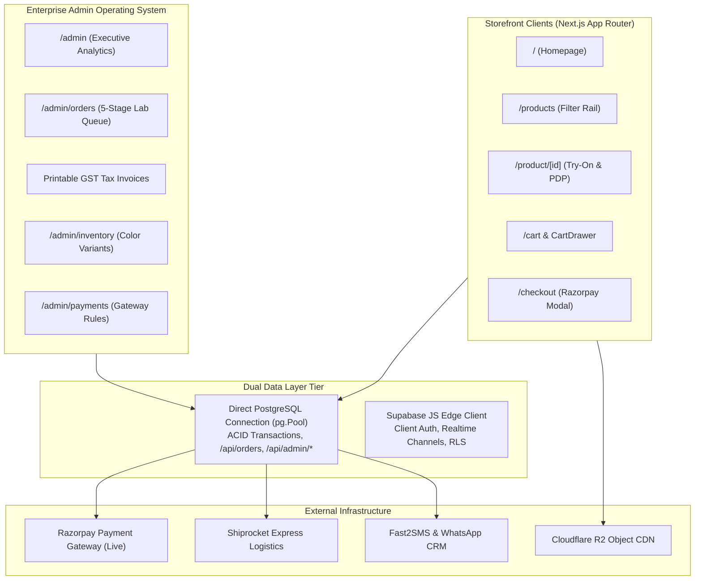

# High-Performance E-Commerce Architecture & System Blueprint

> **System Topology & Software Engineering Manual**  
> *Production Stack: Next.js 16 App Router, PostgreSQL / Supabase, MediaPipe 3D Try-On, Tailwind CSS*

---

## 1. High-Level Architectural Mental Model

The platform operates across two complementary environments:

1. **Luxury Customer Storefront (`/`, `/products`, `/product/[id]`, `/cart`, `/checkout`)**:
   - Atelier brand identity, handcrafted Italian acetate showcase, and bespoke navigation.
   - Interactive clinical lens customizer (Single-vision, Bifocal, Progressive, Blue-light, Zeiss packages).
   - Real-time WebAssembly + Three.js 3D Virtual Try-On using MediaPipe 478 face landmarks.
   - Pincode serviceability & express logistics estimator.
   - Verified Phone OTP patron authentication with persistent cart and wishlist state.
2. **Enterprise Admin Operating System (`/admin`, `/admin/orders`, `/admin/products`, `/admin/settings`, `/admin/payments`)**:
   - Executive command center for inventory, sales analytics, and catalog management.
   - 5-stage optical laboratory assembly queue:
     `Confirmed` → `In Lab Assembly` → `Quality Check` → `Dispatched` → `Delivered`.
   - Comprehensive customer optical prescription viewer (OD/OS measurements + doctor Rx PDF).
   - Printable GST tax invoices formatted with `@media print` using optical HSN codes (`9003` for spectacle frames, `9001` for ophthalmic lenses).
   - SKU-level variant stock & color matrix, Cloudflare R2 image synchronization, and atomic settings store (`public.admin_settings`).



---

## 2. Dual Data Tier Pattern

E-commerce requires both high-speed client-side state resolution and mission-critical ACID financial transactions. To achieve this, the architecture splits into two data tiers:

### Tier 1: Direct PostgreSQL Server Connection (`lib/db.ts` / `lib/pg.ts`)
- **Underlying Technology**: Node.js `pg.Pool` connected via `DATABASE_URL` (Supabase IPv4 Pooler).
- **Usage**: Used inside all server-side API routes (`/api/orders`, `/api/razorpay/*`, `/api/admin/*`, `/api/shipping/*`).
- **Capabilities**:
  - Full ACID transaction support (`BEGIN`, `COMMIT`, `ROLLBACK`).
  - Zero RLS bypass risks (runs on protected server with parameterized SQL).
  - Unrestricted relational joining across `orders`, `order_items`, `products`, `product_variants`, and `admin_settings`.

### Tier 2: Edge Supabase Client (`lib/supabase.ts`)
- **Underlying Technology**: `@supabase/supabase-js` initialized with `NEXT_PUBLIC_SUPABASE_URL` and `NEXT_PUBLIC_SUPABASE_ANON_KEY`.
- **Usage**: Storefront browser bundles and client session management.
- **Capabilities**:
  - Manages patron authentication sessions via Supabase Auth.
  - Subscribes to real-time database channels (e.g. order tracking updates).
  - Enforces Row-Level Security (RLS) policies so patrons can only access their own prescription records.

---

## 3. Next.js App Router Architectural Conventions

### 3.1 `<Suspense>` Boundaries for URL Search Parameters
Any component or page consuming URL query parameters via `useSearchParams()` (such as `/products` filter rail, `/auth/callback`, or `/checkout`) **must** be wrapped in a `<Suspense>` boundary. Failing to do so causes Next.js build-time prerender failures during static optimization.

```tsx
// Pattern: Page component wraps inner search-aware component in Suspense
export default function ProductsPage() {
  return (
    <Suspense fallback={<CatalogLoadingSkeleton />}>
      <ProductsCatalogContent />
    </Suspense>
  );
}
```

### 3.2 Client Navigation: Strict Inviolability of Next.js `<Link>`
- Internal routing must **always** use `<Link href="...">` from `next/link`.
- Raw HTML `<a>` tags for internal paths trigger hard browser page reloads, destroying in-memory cart state, audio context, and causing Flash of Unstyled Content (FOUC).

---

## 4. Universal Settings Architecture (`public.admin_settings`)

All system configurations, store operating hours, contact coordinates, shipping rules, and payment toggles are centrally stored in `public.admin_settings`:

| Key | Purpose | Structure |
|---|---|---|
| `general` | Store identity, phone, address, operating hours | `{ storeName, tagline, contactEmail, contactPhone, address }` |
| `payments` | Gateway toggles, public key IDs, COD rules | `{ razorpayUpi: { enabled, mode, keyId }, cod: { enabled, maxOrderValue } }` |
| `shipping` | Free shipping threshold, default carrier | `{ freeShippingThreshold, standardShippingFee, expressShippingFee }` |
| `loyalty` | Privilege tiers, voucher redemption rules | `{ flat12DiscountPct, welcomeVoucherAmount }` |

- Read and update through `/api/admin/settings` to guarantee transactional integrity.
- Never store raw private secrets in `admin_settings`.

---

## 5. Viewport Geometry & UI Token Translation

When building UI across the platform, strictly enforce Shivam Optical's brand tokens and viewport limits:

- **Atelier Gold (`#C5A059`)**: Primary buttons, active highlights, star ratings, luxury badges.
- **Heritage Forest Green (`#0A251C`)**: Deep luxury accents, header/footer text, card containers.
- **Brand Cream (`#FBF9F5` / `#FAF7F2`)**: Page backgrounds.
- **Soft Warm Border (`#E8DEC8` / `#E8E2D9`)**: Dividing lines, card borders.
- **Strict Zero Unicode Emojis**: Never use unicode emojis in headings, toasts, or UI controls. Always use **Lucide Icons** (`lucide-react`).
- **Max Widths**: PLP Catalog `max-w-[1440px]`, Content `max-w-[1240px]`, Admin Command Center `max-w-[1400px]`.
