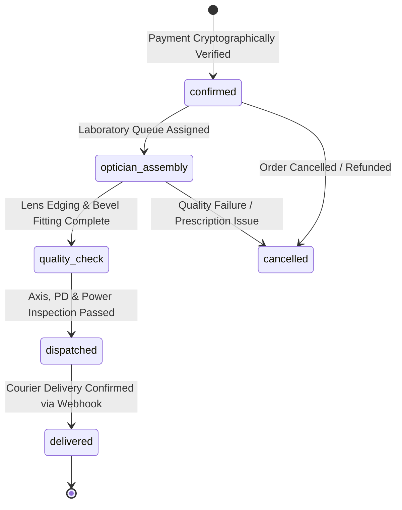

# Optical Laboratory Queue, Order Lifecycle & GST Invoicing

> **Clinical Operating Protocol & Fulfillment Standards**  
> *5-Stage Optical Assembly Queue, HSN Optical Tax Invoices, and Shiprocket Tracking*

---

## 1. 5-Stage Optical Laboratory Assembly Queue

In bespoke clinical optometry and luxury eyewear, fulfillment is not a simple pick-and-pack operation. High-index and progressive ophthalmic lenses require computerized lens edging, frame bevel fitting, digital centration alignment, and strict optical quality inspection.

Every order transitions through 5 sequential states:



### State Definitions
1. **`confirmed`**:
   - Order received, payment cryptographically verified via Razorpay HMAC signature.
   - SMS and WhatsApp confirmation triggered to patron phone number.
   - Stock inventory deducted at the SKU/variant level.
2. **`optician_assembly`**:
   - Master optician downloads OD/OS prescription values.
   - Raw lens blanks (Zeiss, Essilor, or Blue-Block) are mounted on the CNC lens edger.
   - Italian acetate or titanium frame is heated and hand-aligned.
3. **`quality_check`**:
   - Lens power verification using automated lensometer.
   - Pupillary distance (PD) and vertical fitting height measured to ±0.25mm accuracy.
   - Hydrophobic and anti-reflective coating inspection under clinical light.
4. **`dispatched`**:
   - Packed in protective hard case with microfiber cleaning cloth.
   - Air Waybill (AWB) assigned via Shiprocket API.
   - Dispatch tracking SMS with live Shiprocket link sent to patron.
5. **`delivered`**:
   - Carrier delivery milestone confirmed via Shiprocket webhook listener (`/api/webhooks/shiprocket`).
   - Order marked completed in executive analytics.

---

## 2. Optical Clinical Prescription Parameters

When an order includes prescription lenses, the optical customizer serializes diagnostic measurements into the `product_snapshot.prescription` JSON object:

```typescript
export interface OpticalPrescription {
  type: "single_vision" | "bifocal" | "progressive" | "reading" | "computer_zero_power";
  rightEye: {
    sph: string; // Sphere (-20.00 to +12.00)
    cyl: string; // Cylinder (-6.00 to +6.00)
    axis: string; // Axis (1° to 180°)
    add?: string; // Near Addition (+0.75 to +3.50)
  };
  leftEye: {
    sph: string;
    cyl: string;
    axis: string;
    add?: string;
  };
  pupillaryDistance: {
    type: "single" | "dual";
    pd?: string; // e.g. "63.5" mm
    rightPd?: string; // e.g. "31.5" mm
    leftPd?: string; // e.g. "32.0" mm
  };
  doctorName?: string;
  prescriptionDate?: string;
  fileAttachmentUrl?: string; // Stored in R2 / Supabase Storage
}
```

---

## 3. Printable GST Tax Invoice Architecture

### 3.1 Statutory Optical HSN Codes (India GST)
Optical goods in India carry mandatory HSN classification under the Central Goods and Services Tax Act:

| Optical Item Category | Statutory HSN Code | Standard GST Rate |
|---|---|---|
| **Spectacle Frames & Mountings** | **`9003`** | 12% (6% CGST + 6% SGST) |
| **Corrective Ophthalmic Lenses** | **`9001`** | 12% (6% CGST + 6% SGST) |
| **Non-Prescription Sunglasses** | **`9004`** | 18% (9% CGST + 9% SGST) |
| **Contact Lenses** | **`9001`** | 12% (6% CGST + 6% SGST) |

### 3.2 CSS `@media print` Formatting Standard
The tax invoice rendered in `/admin/orders/[id]` must strictly format for standard A4 paper:
- Uses clean black-and-white vector styling with hairline borders (`border-black`).
- Header includes Atelier Letterhead: GSTIN, CIN, registered office coordinates, tax invoice number, and date.
- HSN breakdown table splits Base Value, CGST, and SGST.
- Displays Authorized Signatory block for the certified dispensing optician.

---

## 4. Shiprocket Logistics Integration & Webhook Transitions

Logistics updates arrive via `POST /api/webhooks/shiprocket`:

```typescript
// Mapping Shiprocket webhook events to internal laboratory states:
function mapCarrierStatusToLabStatus(carrierStatus: string): string | null {
  const s = carrierStatus.toUpperCase();
  if (s.includes("DELIVERED")) return "delivered";
  if (s.includes("IN TRANSIT") || s.includes("PICKED UP") || s.includes("OUT FOR DELIVERY")) return "dispatched";
  return null; // Preserve existing state for pre-dispatch milestones
}
```

- Webhook secret verification ensures only authentic Shiprocket webhooks alter dispatch timestamps.
