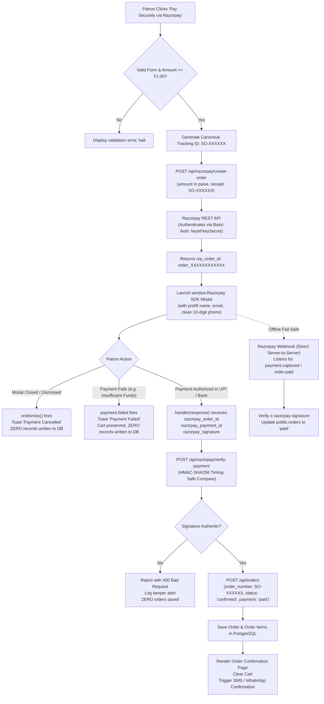

# Razorpay Payment Gateway Integration — The Complete Production Guide

> **Production Architectural Blueprint & Edge-Case Reference**  
> *Active Integration: Shivam Opticals Live Gateway (`rzp_live_Tn3v56njBS0cGX`)*

---

## 1. Overview & Architecture Mental Model

Integrating Razorpay in a luxury e-commerce platform requires more than embedding a client checkout script. It demands a fault-tolerant state machine where:
1. Money debited from a patron's bank is **never lost**, even during network dropouts.
2. Orders are **never created or marked paid** without authentic cryptographic verification from the gateway.
3. Every order receipt, customer invoice, courier label, and database row shares a **single unified tracking number**.
4. Decimal rounding issues (paise drift) are completely eliminated.



---

## 2. Critical Edge Cases & Industrial Solutions

### 2.1 Edge Case 1: The Disconnected Customer (UPI App Drop)
- **Scenario**: A customer on mobile selects GPay/PhonePe. The browser opens the UPI app. The customer enters their UPI PIN, and the bank debits ₹4,500. Before returning to Safari/Chrome, the customer gets a phone call, their phone runs out of battery, or the browser tab closes.
- **Vulnerability**: If the system solely relies on the frontend `options.handler(response)` callback, the server never receives confirmation. The patron lost money, but no order is confirmed.
- **Solution**: The **Razorpay Webhook Fail-Safe**:
  - Razorpay’s server independently pings `POST /api/razorpay/webhook` with event `payment.captured` or `order.paid`.
  - The webhook verifies `x-razorpay-signature` against `RAZORPAY_WEBHOOK_SECRET`.
  - It matches the order via `order_number = paymentEntity.notes.orderNumber` or `payment_details->>'razorpay_order_id' = order_id` and guarantees the order is marked `paid`.

### 2.2 Edge Case 2: Ghost / Abandoned Order Scam Prevention (Option 2 Lifecycle)
- **Scenario**: If orders are created as "pending" in the database before the customer pays, users who open the checkout modal and close it create thousands of orphaned rows in `public.orders`. Attackers can flood the database with bogus orders.
- **Solution**:
  - Do **not** write orders to `public.orders` when the payment modal opens.
  - Write to `public.orders` **only after** `POST /api/razorpay/verify-payment` confirms the cryptographic signature with the server's private secret.
  - Result: Zero ghost orders, zero database clutter, zero risk of unpaid orders being confused with real revenue.

### 2.3 Edge Case 3: The Unified Tracking ID Standard
- **The Bug**: Generating one tracking ID (`SO-100001`) for the Razorpay order receipt, and then generating a second tracking ID (`SO-200002`) in `finalizeOrder()`.
- **The Consequence**: When searching the Razorpay merchant dashboard for `SO-200002`, nothing is found because Razorpay only logged `SO-100001`.
- **Solution**:
  - Generate the canonical `trackingNumber` **once** at the start of `handlePayNow`.
  - Pass this same `trackingNumber` to:
    1. `/api/razorpay/create-order` (`receipt` and `notes.orderNumber`)
    2. `/api/razorpay/verify-payment` (`internal_order_id`)
    3. `finalizeOrder(orderData, trackingNumber)`
    4. Database row (`order_number` and `tracking_number`)
    5. Printable GST tax invoice and Shiprocket courier manifest.

### 2.4 Edge Case 4: Floating-Point Paise Math & Minimum Amount
- **Razorpay Constraint**: Razorpay API strictly operates in **paise** (1 INR = 100 paise) as whole integers. The minimum allowable order is 100 paise (₹1.00).
- **The Bug**: Sending decimal rupees directly (e.g. `2499.50`) or imprecise float calculations (`2499.50 * 100` resulting in `249949.99999999997`).
- **Solution**:
  ```typescript
  // Always use Math.round on the product of amount and 100:
  const amountInPaise = Math.round(Number(totalPayable) * 100);

  // Strictly enforce minimum boundary:
  if (amountInPaise < 100) {
    throw new Error("Amount must be at least ₹1.00 (100 paise)");
  }
  ```

### 2.5 Edge Case 5: Phone Number Formatting for Razorpay Prefill
- Razorpay customer contact prefill expects clean digits (e.g. `9810012345`).
- Passing formatted numbers with spaces or country prefixes (e.g. `+91 98100 12345` or `098100-12345`) can cause client SDK validation warnings.
- **Solution**:
  ```typescript
  const cleanPhone = (shippingAddress.phone || "").replace(/\D/g, "").slice(-10);
  ```

---

## 3. Server-Side HMAC-SHA256 Cryptographic Verification

This is the non-negotiable security barrier preventing payment forgery.

```typescript
// app/api/razorpay/verify-payment/route.ts
import { NextResponse } from "next/server";
import crypto from "crypto";

export async function POST(req: Request) {
  const body = await req.json();
  const { razorpay_order_id, razorpay_payment_id, razorpay_signature } = body;

  if (!razorpay_order_id || !razorpay_payment_id || !razorpay_signature) {
    return NextResponse.json({ success: false, error: "Missing required signature fields" }, { status: 400 });
  }

  // Key secret is ONLY read from server-side process.env
  const keySecret = process.env.RAZORPAY_KEY_SECRET;
  if (!keySecret) {
    return NextResponse.json({ success: false, error: "Server configuration error" }, { status: 500 });
  }

  // 1. Generate expected HMAC-SHA256 signature
  const expectedSignature = crypto
    .createHmac("sha256", keySecret)
    .update(`${razorpay_order_id}|${razorpay_payment_id}`)
    .digest("hex");

  // 2. Perform timing-safe buffer comparison
  const sigA = Buffer.from(expectedSignature, "utf8");
  const sigB = Buffer.from(razorpay_signature, "utf8");

  if (sigA.length !== sigB.length || !crypto.timingSafeEqual(sigA, sigB)) {
    console.warn(`[RAZORPAY] Forgery attempt: Incoming signature mismatch for order ${razorpay_order_id}`);
    return NextResponse.json({ success: false, error: "Invalid payment signature" }, { status: 400 });
  }

  return NextResponse.json({
    success: true,
    verified: true,
    orderId: razorpay_order_id,
    paymentId: razorpay_payment_id,
    verificationMethod: "hmac_sha256_timing_safe",
  });
}
```

---

## 4. Production Webhook Setup Guide (Razorpay Dashboard)

To activate server-to-server webhook fail-safe:

1. Log in to your [Razorpay Dashboard](https://dashboard.razorpay.com).
2. Switch to **Live Mode** in the top-left toggle.
3. Navigate to **Account & Settings** (gear icon) → **Webhooks** (under Website & App Settings).
4. Click **+ Add New Webhook**.
5. Fill in the fields:
   - **Webhook URL**: `https://shivamoptical.in/api/razorpay/webhook`
   - **Secret**: `shivam_opticals_webhook_sec_2026`
   - **Alert Email**: Enter your notification email (e.g. `info@shivamoptical.in`).
   - **Active Events**: Check the following 3 events:
     - `payment.captured`
     - `order.paid`
     - `payment.failed`
6. Click **Save Webhook**.

---

## 5. Verification Checklist

- [x] Live API Key `rzp_live_Tn3v56njBS0cGX` verified active with Razorpay servers.
- [x] Live Secret Key `5B0VMymOFpkJfPsiE1sBWaSy` configured in `.env.local` / `.env`.
- [x] Zero secret keys stored in PostgreSQL `public.admin_settings`.
- [x] `app/checkout/page.tsx` passes single unified `trackingNumber` across all layers.
- [x] Option 2 lifecycle active: zero ghost records in database on cancelled payments.
- [x] Timing-safe HMAC verification active in `app/api/razorpay/verify-payment`.
- [x] Webhook route verifies `x-razorpay-signature` and updates order status idempotently.
