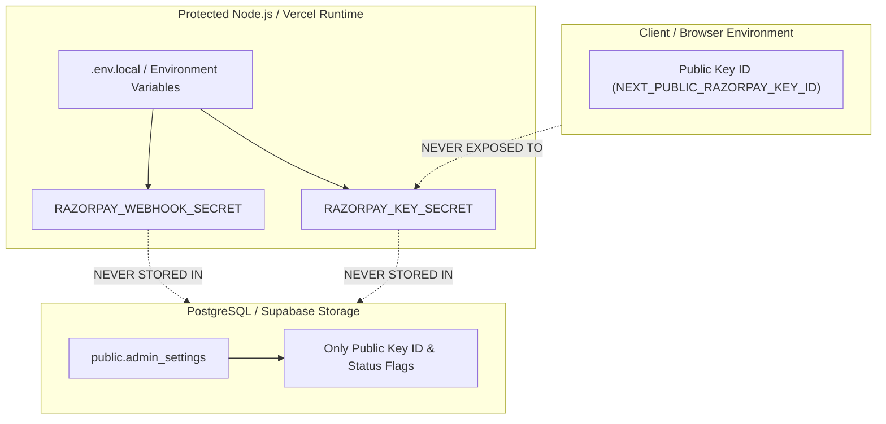

# Enterprise E-Commerce Security Architecture & Threat Defense

> **Authoritative Specification & Operational Manual**  
> *Engineered for Shivam Opticals Atelier & Enterprise E-Commerce Systems*

---

## 1. Executive Summary & Core Threat Model

In modern high-transaction e-commerce platforms, payment gateways, customer optical medical records, and inventory data represent high-value attack surfaces. A failure in cryptographic validation, credential isolation, or database query hygiene can lead to financial fraud, unauthorized order placement, data exfiltration, or merchant credential hijacking.

This document establishes the binding security standards implemented in this repository. All future agents, developers, and microservices must adhere strictly to these principles.

---

## 2. Inviolable Rule: Zero Secrets in the Database

### 2.1 The Vulnerability
A common architectural antipattern is storing payment gateway secret keys, SMS API tokens, or webhook secrets in database configuration tables (such as `public.admin_settings`). If an attacker exploits an administrative vulnerability, a compromised backup, an accidental SQL dump, or an edge API route that queries settings, raw private secrets are immediately exposed.

### 2.2 The Implementation Standard
- **The Rule**: **NEVER store private API secrets or signature keys in PostgreSQL or Supabase tables.**
- **Private Secrets**:
  - `RAZORPAY_KEY_SECRET`
  - `RAZORPAY_WEBHOOK_SECRET`
  - `DATABASE_PASSWORD` / `DATABASE_DIRECT_URL`
  - `FAST2SMS_API_KEY`
  - `SHIPROCKET_PASSWORD` / `SHIPROCKET_WEBHOOK_SECRET`
  - `R2_SECRET_ACCESS_KEY`
- **Permissible Database Values**: Only public configuration identifiers may be stored in `public.admin_settings`:
  - `keyId` (e.g., `rzp_live_Tn3v56njBS0cGX`)
  - `mode` (`"live"` or `"test"`)
  - `enabled` (`true` or `false`)
  - Masked presentation strings for the Admin UI (`rzp_live_••••••••••••••••cGX`)



---

## 3. SQL Injection Defense: Parameterized Query Standard

### 3.1 The Vulnerability
Directly concatenating client-supplied variables into SQL strings allows attackers to escape quotes, inject arbitrary queries, bypass authentication, or truncate tables (e.g. `' OR '1'='1' --`).

### 3.2 The Implementation Standard
Every database query in `lib/db.ts`, `lib/pg.ts`, `/api/orders`, and `/api/admin/*` must strictly use **parameterized placeholders (`$1, $2, ...`)** via the Node `pg.Pool` client.

```typescript
// ❌ CRITICAL SECURITY VULNERABILITY (NEVER DO THIS):
const badQuery = `SELECT * FROM public.orders WHERE order_number = '${userInput}'`;
await pool.query(badQuery);

// ✅ INDUSTRIAL SECURE IMPLEMENTATION (ALWAYS DO THIS):
const secureQuery = `
  SELECT id, order_number, total_amount, payment_status 
  FROM public.orders 
  WHERE order_number = $1 OR tracking_number = $1;
`;
const result = await pool.query(secureQuery, [userInput.trim()]);
```

- When storing JSON payloads (`payment_details`, `shipping_address`, `product_snapshot`), always pass the stringified object as a parameter cast to `$N::jsonb`.

---

## 4. Cryptographic Payment Verification & Timing-Safe Comparisons

### 4.1 The Vulnerability: Timing Attacks
Standard string comparison operators (`===` or `==`) compare strings character by character and return `false` as soon as the first differing byte is found. An attacker measuring microsecond response timing over thousands of requests can incrementally guess authentic HMAC signatures.

### 4.2 The Implementation Standard
All HMAC-SHA256 signature verifications must enforce:
1. **Length Verification**: Ensure the incoming signature buffer and generated signature buffer have identical byte lengths before comparison.
2. **Timing-Safe Equality**: Use `crypto.timingSafeEqual(bufferA, bufferB)`, which runs in constant time regardless of where differences occur.

```typescript
import crypto from "crypto";

export function verifyHmacSignature(
  orderId: string,
  paymentId: string,
  signature: string,
  secret: string
): boolean {
  if (!orderId || !paymentId || !signature || !secret) {
    return false;
  }

  // Algorithm: HMAC-SHA256(order_id + "|" + payment_id, KEY_SECRET)
  const expectedSignature = crypto
    .createHmac("sha256", secret)
    .update(`${orderId}|${paymentId}`)
    .digest("hex");

  try {
    const sigA = Buffer.from(expectedSignature, "utf8");
    const sigB = Buffer.from(signature, "utf8");

    // Guard: Different buffer lengths cause timingSafeEqual to throw an unhandled RangeError
    if (sigA.length !== sigB.length) {
      return false;
    }

    return crypto.timingSafeEqual(sigA, sigB);
  } catch (err) {
    console.error("[CRYPTO] Timing-safe verification error:", err);
    return false;
  }
}
```

---

## 5. Webhook Signature Authentication & Replay Protection

### 5.1 Webhook Verification Protocol
Razorpay webhooks transmit an `x-razorpay-signature` header computed from the raw HTTP body and your webhook secret:
- **Raw Body Preserved**: Next.js App Router must consume `req.text()` directly. Parsing JSON before computing HMAC alters whitespace and line endings, causing signature mismatch.
- **Header Check**: If `x-razorpay-signature` does not match `HMAC-SHA256(rawBody, RAZORPAY_WEBHOOK_SECRET)`, immediately terminate with `400 Bad Request`.
- **Idempotency**: Webhook handlers must be safe to execute multiple times. If `payment_status` is already `'paid'`, record the webhook event timestamp and return `200 OK` without duplicating fulfillment actions.

---

## 6. Patron Authentication & Clinical Data Privacy

1. **Medical Privacy (IT Act 2000 & DPDP Act 2023)**:
   - Patient optical measurements (Sphere, Cylinder, Axis, Pupillary Distance, Add Power, and Doctor Rx PDFs) are stored in `public.prescriptions` and linked to `customer_id`.
   - Never expose raw prescription data in public storefront catalog routes.
2. **Phone OTP Verification**:
   - OTP codes are generated as cryptographically pseudo-random 6-digit tokens (`Math.floor(100000 + Math.random() * 900000)`).
   - Stored in `public.otp_verifications` with a maximum TTL of 10 minutes (`expires_at = NOW() + INTERVAL '10 minutes'`).
   - Invalid attempts are tracked; after 5 failed attempts, the OTP is invalidated.
3. **Session Cookies**:
   - Admin and patron authenticated tokens are stored in `HttpOnly`, `SameSite=Lax`, `Secure` cookies, preventing client-side JavaScript (XSS) from reading session tokens.

---

## 7. Security Checklist for Any New E-Commerce Flow

- [ ] Private API keys reside exclusively in `.env.local` / system environment variables.
- [ ] Database queries utilize `$1, $2, ...` placeholders — zero inline string interpolation.
- [ ] Signatures from third-party payment gateways use `crypto.timingSafeEqual`.
- [ ] Webhook endpoints verify signatures on raw body text before parsing payload JSON.
- [ ] Financial calculations happen on the server in whole integers (paise / cents) to prevent float inaccuracies.
- [ ] Administrative endpoints authenticate the session cookie before returning data.
